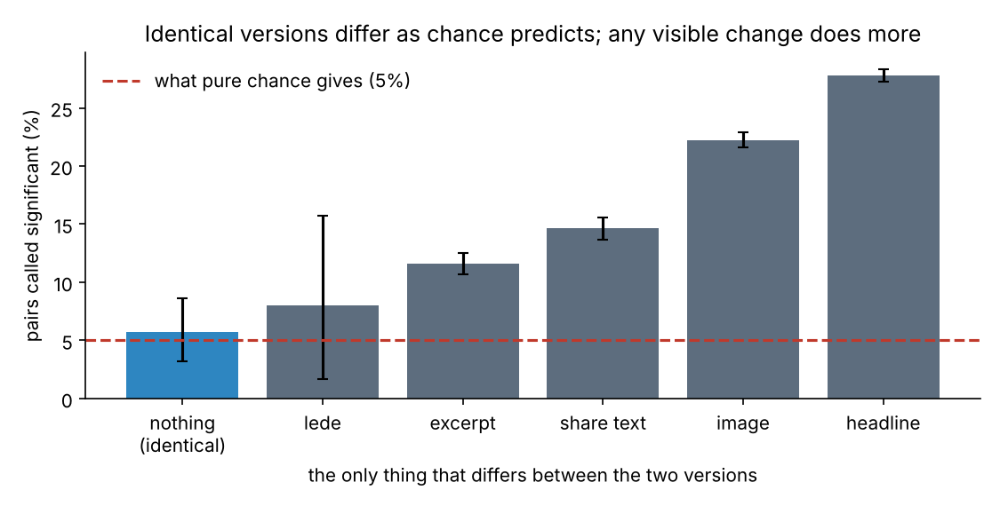

# ab-test-reliability

How reliable are A/B test decisions? An analysis of real headline A/B tests from the
[Upworthy Research Archive](https://upworthy.natematias.com/) (Cornell University, CC BY 4.0).

**Finding:** on versions that were truly identical, the standard noise formula held (noise x1.14, 95% CI
0.96-1.34). The tests were simply too small: only 23% of comparisons between two versions reached
significance, and the editors' final picks were truly better than the best alternative about 60% of the
time. Eight predictions were registered in git before the main data was opened; five held, and three
failed after an audit corrected the definition of "identical versions" (the first definition counted
versions with different share texts as identical). Full write-up: **[REPORT.md](REPORT.md)**.



| | Result (confirmatory sample) |
|---|---|
| Identical versions flagged "significant" at 5% | 5.7% (noise x1.14, 95% CI 0.96-1.34) |
| Versions differing only in share text flagged "significant" | 14.6% (documented as not shown in tests) |
| Comparisons between two versions that reach significance | 23% |
| Significant results pointing the wrong way | 5.7% |
| Median exaggeration of significant gains | x1.5 |
| Editors' picks truly better than the best alternative | 59% |
| False winners when peeking (20 looks) vs one look | 10.6% vs 2.9% |
| Clicks per extra negative / positive word | +1.6% / -2.0% (replicates Robertson et al., 2023) |
| Local LLM (Qwen3-8B) picking the winner of a pair | 52.4% |

## Data

Download the CSV files from [osf.io/jd64p](https://osf.io/jd64p/) (folder `upworthy-archive-datasets`)
into `data/raw/`. Everything is developed on the exploratory sample; the confirmatory and holdout samples
open only through `scripts/run_plan.py`, which checks that the plan and code are committed first.

## Run

```bash
pip install -r requirements.txt
python scripts/check_data.py            # data checks, randomization (SRM) test
python scripts/analyze_effects.py       # A/A noise, true lifts, reliability of decisions (~5 min)
python scripts/simulate_stopping.py     # stopping rules
python scripts/reproduce_negativity.py  # replication of Robertson et al. (2023)
python scripts/llm_pick_winner.py       # LLM experiment, needs Ollama with qwen3:8b (~25 min)
python scripts/llm_pick_winner.py --rate
python scripts/run_plan.py confirmatory # the frozen plan on the reserved sample
python scripts/check_identical_versions.py   # post-hoc: noise on identical versions, effect of each field
```

| folder | contents |
|---|---|
| `sql/` | DuckDB queries: one row per version, one row per test |
| `src/abtr/` | loading, empirical Bayes (NPMLE), sentiment counts |
| `scripts/` | one script per question |
| `results/`, `figures/` | outputs (exploratory); reserved samples in subfolders |
| `demo/` | "Is my winner real?": a calculator built on these results (static page; `scripts/export_prior.py`, `scripts/build_demo.py`) |
| `docs/analysis_plan.md`, `docs/deviations.md` | the pre-registered plan and the two deviations |
