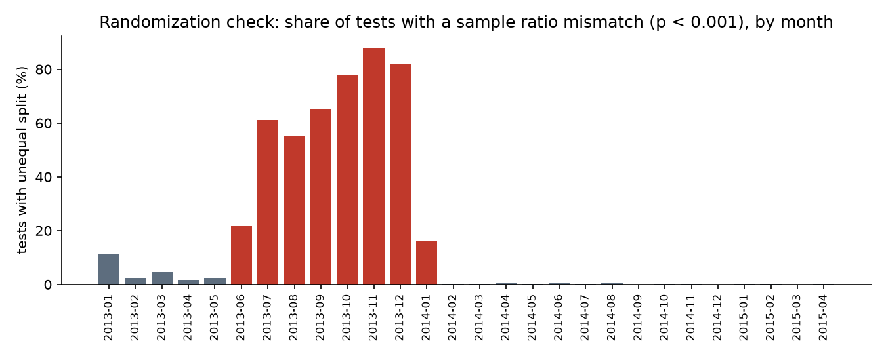
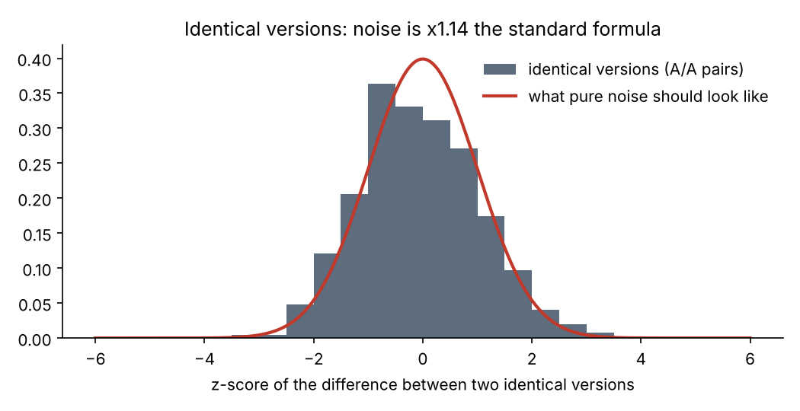
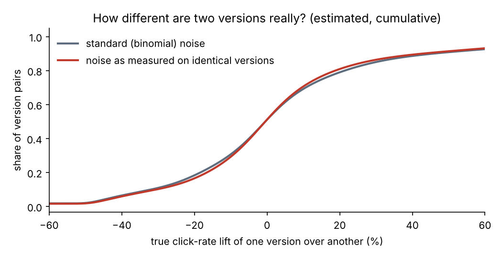
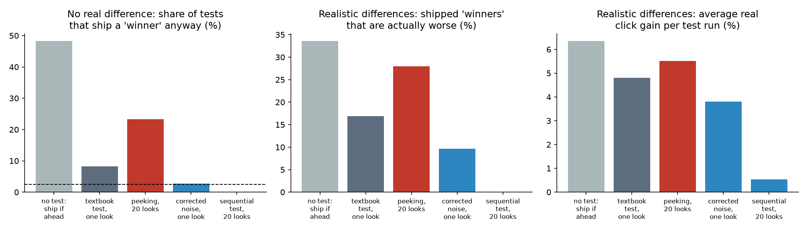

# How reliable are A/B test decisions? Evidence from 22,743 real headline tests

**In short:** in Upworthy's headline tests, the noise was about 1.9 times what the standard formula
assumed. As a result, about 1 in 5 "significant" winners was actually the worse headline, measured gains
were exaggerated about 4 times, and the editors' final picks were barely better than a coin flip. Checking
results repeatedly makes this about three times worse. All eight predictions, registered before the main
data was opened, held on the 22,743 confirmatory tests and on a further 4,871 holdout tests.

Numbers below are from the **confirmatory sample** unless stated; holdout values in brackets.

## The data and the method

- **Data:** the [Upworthy Research Archive](https://upworthy.natematias.com/) (Matias et al., 2021, CC BY 4.0).
  From 2013 to 2015 the news site Upworthy tested headlines: each visitor was randomly shown one version of
  an article's headline, image and excerpt, and clicks were counted. The archive is split into three samples.
- **Discipline:** all code was written on the exploratory sample (4,873 tests). The analysis plan, with
  eight predictions, was then committed to git ([docs/analysis_plan.md](docs/analysis_plan.md), commit
  `d7e380a`) before the confirmatory and holdout samples were opened, and run once on each.
  One deviation was needed ([docs/deviations.md](docs/deviations.md)): one holdout version had no headline.
- **Tools:** SQL (DuckDB) for all loading and counting; Python (NumPy, SciPy, statsmodels) for the
  statistics and simulations; Qwen3-8B through Ollama for the LLM experiment.

| Prediction (plan) | Result | Held? |
|---|---|---|
| H0 Randomization problem visible in 2013 | 70% of tests with an unequal split in the flagged period vs 0.5% outside | Yes |
| H1 Noise larger than binomial | x1.88 (95% CI 1.73-2.10) [x1.74] | Yes |
| H2 Typical true difference below 10% | 6% [7%] | Yes |
| H3 Significant results often wrong or exaggerated | 20% wrong direction, exaggerated x4.3 [17%, x2.8] | Yes |
| H4 Editors' picks below 70% reliable | 54% [56%] | Yes |
| H5 Peeking at least doubles false winners | 23% vs 8% [21% vs 7%] | Yes |
| H6 Negative words raise clicks, positive words lower them | +1.6% and -2.0% per word [+0.7% n.s., -2.1%] | Yes |
| H7 LLM near chance on pairs, better when rating alone | 52.6% on pairs; 70% when rating, pairs without ties | Yes |

## 0. Some tests were not properly randomized

A test should show each version to roughly the same number of people. A **sample ratio mismatch** (SRM,
chi-square test, p < 0.001) means it did not, so randomization failed. **70%** of tests started between
June 2013 and January 2014 have one, against **0.5%** outside that period: we recover, from the data
alone, the problem the archive authors reported in 2024. These 4,907 tests and all other SRM tests are
excluded; **17,744 tests remain**.

## 1. The noise is almost twice what Upworthy assumed

In 1,905 tests, some versions were identical before the click (same headline, image and excerpt): accidental
**A/A tests**, where any difference is pure chance. A 5% significance test should flag 5% of them; it flags
**14.7%**. The spread of their differences is **1.88 times** the binomial formula's (95% CI 1.73-2.10;
holdout 1.74). P-values computed the standard way on this platform were therefore too optimistic.
This check is, as far as we found, not reported elsewhere.

## 2. Real differences between headlines are modest

Removing the noise (empirical Bayes: nonparametric maximum likelihood over 157,570 version pairs in 16,363
tests, each test weighted once) gives the distribution of **true** click-rate differences between two versions of an article.
With the measured noise, the typical (median) true difference is **6%**; 37% of pairs differ by less than
5%. The standard formula would suggest 15%. A minority of versions differ a lot (20% of pairs by more than 20%).

## 3. "Significant" does not mean right

Simulating tests with the real test sizes and true differences drawn from section 2:

| Noise model | Significant results in the wrong direction | Median exaggeration of significant gains |
|---|---|---|
| Standard (binomial) | 3.5% | x1.4 |
| Measured on A/A tests | **20%** | **x4.3** |

**The editors' picks.** Upworthy's `winner` field records the version editors kept. Given the data, the
chance that it truly beat the best other version averages **54%** (61% with the standard formula), and for
96% of picks it is below 80%.

**Test size.** A typical version was shown to about **3,100** people. Detecting a 5% improvement with 80%
power needs about **1.07 million** per version with the measured noise (570,000 with the standard
formula); a 20% improvement needs about 76,500.

## 4. What stopping early costs

40,000 simulated tests copy real ones and receive their visitors in 20 batches. A new headline B replaces
the current A only when a rule says so.

| Rule | No real difference: false winners | Realistic: shipped winners that are worse | Realistic: average real gain per test |
|---|---|---|---|
| No test, ship B if ahead | 48% | 34% | **6.3%** |
| Standard test, one look | 8.3% | 17% | 4.8% |
| Peeking: 20 looks, stop at p < 0.05 | **23%** | 28% | 5.5% |
| One look, noise corrected | **2.7%** | 10% | 3.8% |
| Sequential test (mixture SPRT), corrected | 0% | 0% | 0.5% |

The expected false-winner rate is 2.5% (one-sided). Peeking nearly triples false winners; correcting the
noise restores the intended error rate. **But strict control is not free:** the bolder the rule, the higher
the average gain, because headline mistakes are small and reversible. With tests this small, the
sequential test almost never concludes. The right rule depends on what a wrong decision costs.

## 5. What makes a headline win, and can an LLM tell?

**Negative words (replication).** With the open VADER dictionary instead of the commercial LIWC, a
within-test regression gives **+1.6%** clicks per extra negative word and **-2.0%** per positive word
(standardized betas 0.012 and -0.017, both 95% CIs excluding zero). Robertson et al. (2023, *Nature Human
Behaviour*) report +2.3% and -1.0% on the same sample, with their own filters. Holdout: -2.1% for positive words; +0.7% for
negative words, same direction but not significant.

**LLM.** On 2,152 pairs with a clear winner, Qwen3-8B (local, no reasoning) was asked which headline got
more clicks, with both orders tried:

- comparing the pair: **52.6%** correct (95% CI 51.1-54.1%), because it answered "A" 93% of the time;
- rating each headline alone (1-10): 69% of pairs tied (it gave most headlines an 8), but on the other 668
  pairs it picked the winner **70%** of the time (66-73%). Counting ties as half: 56%.

A small local model has some sense of clickability, hidden by position bias and a compressed scale. It
does not replace a test. Larger models were not tested.

## Limits

- The data are 2013-2015 news headlines; effect sizes in e-commerce or apps differ.
- Stopping early is simulated: the archive has final totals only.
- The extra noise is measured on versions identical before the click; we assume it applies to all tests.
  Its cause is not identified (possibly visitors being assigned in clusters rather than one by one).
- The `winner` field is an editorial choice, not always the test's statistical winner.

## Reproduce

See [README.md](README.md). Every number above is in `results/confirmatory/` and `results/holdout/`.
